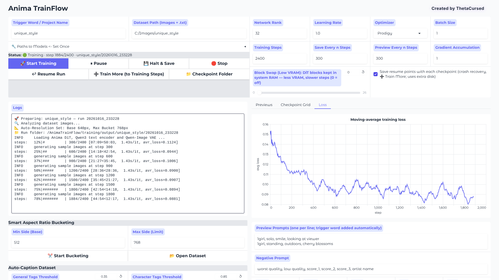

# Anima TrainFlow — Fork

A one-page GUI for training LoRAs on the **Anima 2B** anime model, tuned for NVIDIA GPUs with as little as **6 GB of VRAM**.

This is a fork of [ThetaCursed/Anima-TrainFlow](https://github.com/ThetaCursed/Anima-TrainFlow), which created the app. The fork keeps the same workflow and focuses on making long training runs hard to lose and checkpoints easy to choose. It is not affiliated with or endorsed by the upstream project.

`Raw Images` ➔ `Smart Resize & Crop` ➔ `Auto-Tag` ➔ `Inspect` ➔ `Train` ➔ `Compare Checkpoints` ➔ `Ready LoRA`

> **Current version: 1.2.1** — see [CHANGELOG.md](CHANGELOG.md) and [Releases](https://github.com/new525/Anima-TrainFlow-fork/releases).
> Fork versions are numbered independently of upstream. Fork 1.1 was built on upstream's v1.1.0 code.

---

## How this fork differs from upstream

| | Upstream (v1.1.0) | This fork (1.2.1) |
|---|---|---|
| **Refreshing the page during training** | The trainer hangs on a full output pipe, keeping its VRAM, and Stop can no longer reach it | Training carries on; any tab shows the live run |
| **Closing or restarting the app during training** | Training ends | Training carries on; the restarted app reattaches to it |
| **Interrupting a run** | Stop only (progress lost) | ⏸ Pause, 💾 Halt & Save, ↩ Resume Run, crash recovery from resume points |
| **Continuing a finished run** | — | ➕ Train More extends it to a higher step count |
| **Low VRAM** | No block swapping | Block Swap slider (up to 26 of 28 DiT blocks in system RAM) |
| **Output folders** | One folder per keyword, shared by every run (earlier checkpoints overwritten); keywords with no Latin letters or digits all go to `untitled` | One folder per run: `output/<keyword>/<date_time>/`; any keyword |
| **Picking a checkpoint** | One preview prompt, unlabelled gallery | Several prompts, step × prompt grid, live loss chart, labelled previews |
| **Re-running bucketing with new sizes** | Can overwrite your original images with crops | Non-destructive; originals are never touched |
| **Phone photos** | Bucket chosen from unrotated size: cropped the wrong way | Rotated upright first |
| **Dataset checks** | Pre-flight (its oversized-image check never fired) | Working pre-flight plus 🔎 Inspect Dataset |
| **Bucketing / tagging during a refresh** | Interrupted with the tab | Run in the background |
| **Trigger word prefix** | `trigger,  tags` (double space); added even if captions already contain it | `trigger, tags`; skipped when every caption has it |

The complete list, including smaller fixes, is in [CHANGELOG.md](CHANGELOG.md).


*The fork's interface during a training run, with the Loss tab open (demo run).*

---

## Installation (Windows)

> **Don't use upstream's 3 GB portable download for this fork.** It contains upstream's code, so you would get none of the changes above. This fork already bundles its own Python, so no portable build is needed.

**Requirements**
* Windows 10/11.
* An NVIDIA GPU (6 GB+ VRAM) with a driver recent enough for CUDA 12.8; the installer uses PyTorch's CUDA 12.8 build.
* Free disk space for PyTorch, the model files, and your runs. Resume points include optimizer state and are much larger than a LoRA.

### 1. Get the fork
* **Easiest:** download the zip from [Releases](https://github.com/new525/Anima-TrainFlow-fork/releases) and extract it to a folder of your choice.
* **Or with git:**
  ```bash
  git clone https://github.com/new525/Anima-TrainFlow-fork
  cd Anima-TrainFlow-fork
  ```

Either way you get `python_embeded/`, an embedded Python 3.10 with pip. There's no separate Python to install.

### 2. Install dependencies
Run **`Install_Requirements.bat`**. It installs PyTorch (CUDA 12.8) and the training dependencies into `python_embeded/`.

### 3. Download the models
Put each file in the folder shown; these are the paths the app uses by default. If you already have the files elsewhere, for example in ComfyUI, you can point the app at them instead (step 4).

| What | File | Put it in | Download |
|---|---|---|---|
| Anima DiT (base) | `anima-base-v1.0.safetensors` | `models/anima/dit/` | [circlestone-labs/Anima](https://huggingface.co/circlestone-labs/Anima/blob/main/split_files/diffusion_models/anima-base-v1.0.safetensors) |
| Text encoder (Qwen3 0.6B) | `qwen_3_06b_base.safetensors` | `models/anima/text_encoder/` | [circlestone-labs/Anima](https://huggingface.co/circlestone-labs/Anima/blob/main/split_files/text_encoders/qwen_3_06b_base.safetensors) |
| VAE (Qwen-Image) | `qwen_image_vae.safetensors` | `models/anima/vae/` | [circlestone-labs/Anima](https://huggingface.co/circlestone-labs/Anima/blob/main/split_files/vae/qwen_image_vae.safetensors) |
| WD tagger (auto-captioning) | `model.onnx` + `selected_tags.csv` | `models/wd-eva02-large-tagger-v3/` | [model.onnx](https://huggingface.co/SmilingWolf/wd-eva02-large-tagger-v3/resolve/main/model.onnx) (1.26 GB), [selected_tags.csv](https://huggingface.co/SmilingWolf/wd-eva02-large-tagger-v3/resolve/main/selected_tags.csv) |
| U2Net (smart cropping) | `u2net.onnx` | `models/u2net/` | [u2net.onnx](https://github.com/danielgatis/rembg/releases/download/v0.0.0/u2net.onnx) |

* The Anima model card says LoRAs should be trained on the **base** model, which is why it's listed here.
* Anima is released under the CircleStone Labs Non-Commercial License; read its terms on the model page.
* For the tagger, download just the two files rather than cloning the repo. A clone also pulls two other formats of the same model, 3.78 GB in total.

### 4. Launch
Run **`start_trainer.bat`**; the UI opens in your browser. If your model files aren't in the default folders, set their paths once under **🔧 Paths to Models**.

### Updating
* **git:** run `git pull`.
* **Zip:** extract the new release, then copy the *contents* of its top folder over your existing install. The zip doesn't contain your settings (`training/settings.json`), runs (`training/output/`) or installed packages, so they are kept.
* Re-run `Install_Requirements.bat` when the changelog says dependencies changed. **1.2.1 changed one:** it updates Gradio.

---

## Using it

### Prepare the dataset
Put your images (`.png`, `.jpg`, `.jpeg`, `.webp`, `.bmp`) in one folder and set it as **Dataset Path**. Then:

1. **✂️ Start Bucketing** resizes and crops images to training buckets.
   * Your originals are moved to `original_images/` and never modified.
   * Running it again with different sizes regenerates the crops from those originals.
2. **Create .txt captions** auto-tags every image with the WD tagger.
3. **🔎 Inspect Dataset** checks the result before you spend an hour training:
   * missing, empty or orphaned captions
   * oversized, small, unreadable or rotated images
   * repeated tags, and the trigger word already in some captions
   * the most frequent tags, and tags present in every caption

These three tools run in the background; their progress shows in the log.

### Train
Set a **Trigger Word**, which also names the run's folder, then press **🚀 Start Training**. The status line above the buttons always shows what's running.

| Button | What it does |
|---|---|
| ⏸ **Pause / ▶ Continue** | Freezes training instantly and continues exactly where it stopped. VRAM stays allocated while paused. |
| 💾 **Halt & Save** | Finishes the current step, saves a LoRA and a full resume point, then exits and frees the VRAM. |
| 🛑 **Stop** | Ends training immediately, without saving. |
| ↩ **Resume Run** | Continues the keyword's newest unfinished run (halted or crashed) from its newest resume point, using the settings it was started with. |
| ➕ **Train More** | Extends the keyword's newest *finished* run up to the current **Training Steps** value. The previous final LoRA is kept. |

More options:
* **Block Swap (Low VRAM):** keeps that many of the 28 DiT blocks in system RAM. This lowers VRAM use at the cost of slower steps. Use it if training runs out of memory.
* **Save resume points with each checkpoint** (on by default): saves a resume point with every checkpoint and keeps the newest two. A crash then costs at most one save interval, and ➕ Train More becomes possible.
* You can refresh the page, close it, or even close the console window and restart the app. Training keeps going, and the restarted app reconnects to it.

### Choose the best checkpoint
* **Preview Prompts:** write one prompt per line. Each is rendered at every preview step, with the trigger word added.
* **Checkpoint Grid** tab: one image of every step × prompt, with steps that saved a LoRA marked.
* **Loss** tab: the moving-average loss over the run.

### Where things go
```
training/output/<keyword>/<YYYYmmdd_HHMMSS>/   one folder per run
├── <keyword>.safetensors                      final LoRA
├── <keyword>-step00000300.safetensors         checkpoints
├── <keyword>-step00000300-state/              resume points
├── sample/                                    previews
├── checkpoint_grid.png
├── configs/  logs/  run.json
```

---

## Status

* **Tested:** the fork's changes have been tested end to end on Python 3.10, the bundled version, with the real app and a stand-in trainer that mimics the real one's files and output.
* **Browser-tested:** the interface has been exercised in headless Chromium. That covers switching tabs mid-run, the loss chart updating, previews, and settings surviving a page refresh.
* **Not yet confirmed:**
  * On a real GPU: halt/resume through the bundled trainer, and block swap's VRAM savings.
  * On Windows: training surviving a closed console window.

See *Known limitations* in [CHANGELOG.md](CHANGELOG.md), and please open an issue if something misbehaves.

## Technical details
* **Core:** a modified `sd-scripts` for the Anima architecture. This fork adds a halt-request hook and fixes the step count when resuming with gradient accumulation.
* **UI:** Gradio 6.17.3 (the newest release compatible with sd-scripts' pinned `huggingface-hub==0.34.3`). The trainer runs as a separate process launched with `accelerate launch`, and the UI follows its log file.
* **Defaults:** BF16, latent and text-encoder caching, and the Prodigy optimizer with a constant learning rate; AdamW uses a cosine schedule.
* **Settings** are auto-saved to `training/settings.json`.

## Credits & license
Anima TrainFlow was created by **ThetaCursed** ([upstream repository](https://github.com/ThetaCursed/Anima-TrainFlow)). This fork's changes are released under the same [MIT License](LICENSE). Anima model weights are © CircleStone Labs under their own license. The bundled `sd-scripts` is by kohya-ss.
